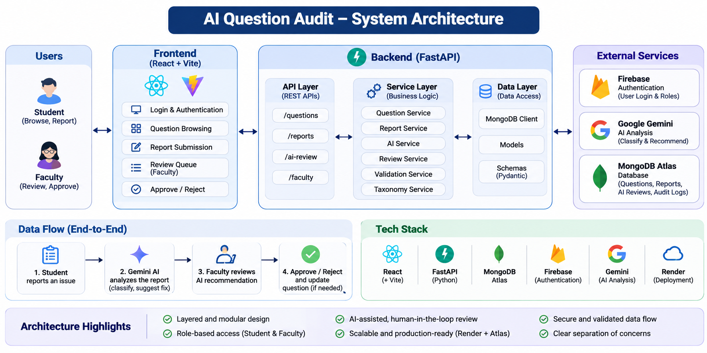

# AI Question Audit

An AI-powered web application for reviewing, auditing, and managing JEE/NEET practice questions. The platform enables students to report issues in questions, allows faculty to review reports, and leverages Google's Gemini AI to assist in analyzing reported questions.

---

## Live Demo

### Frontend

<https://ai-question-audit-1.onrender.com>

### Backend API

<https://ai-question-audit.onrender.com>

### API Documentation (Swagger)

<https://ai-question-audit.onrender.com/docs>

---

## Features

### Student Module

- Secure login
- Browse all practice questions
- Search questions
- Filter by subject
- Filter by question type
- Report incorrect questions
- View report submission status

### Faculty Module

- Faculty authentication
- Dashboard with report statistics
- View pending reports
- Approve reports
- Reject reports
- AI-assisted report analysis
- Manage question quality

### AI Integration

- Gemini AI powered report analysis
- Automated issue explanation
- Suggested resolutions
- AI-assisted faculty review

---

## Tech Stack

### Frontend

- React
- Vite
- React Router
- Axios
- CSS

### Backend

- FastAPI
- Python
- Motor (Async MongoDB Driver)
- Pydantic
- Uvicorn

### Database

- MongoDB Atlas

### AI

- Google Gemini API

### Deployment

- Render (Backend)
- Render Static Site (Frontend)

---

## System Architecture



---

## Project Structure

```text
AI_Question_Audit/
├── Backend/
│   ├── app/
│   │   ├── api/
│   │   ├── core/
│   │   ├── data/
│   │   ├── database/
│   │   ├── middleware/
│   │   ├── models/
│   │   ├── schemas/
│   │   ├── services/
│   │   └── utils/
│   ├── main.py
│   ├── requirements.txt
│   └── .env.example
├── frontend/
│   ├── src/
│   │   ├── components/
│   │   ├── pages/
│   │   ├── services/
│   │   ├── hooks/
│   │   └── App.jsx
│   ├── package.json
│   └── .env.example
├── README.md
└── LICENSE
```

---

## Installation

### Clone Repository

```bash
git clone https://github.com/prathikreddy19/AI_Question_Audit.git
cd AI_Question_Audit
```

---

## Backend Setup

```bash
cd Backend
python -m venv venv
```

macOS / Linux:

```bash
source venv/bin/activate
```

Windows PowerShell:

```powershell
venv\Scripts\Activate.ps1
```

Install dependencies:

```bash
pip install -r requirements.txt
```

Create `Backend/.env` using `Backend/.env.example` as a template:

```env
MONGODB_URI=your_mongodb_connection_string
DATABASE_NAME=AI_Question_Audit
GEMINI_API_KEY=your_gemini_api_key
```

Run backend from the `Backend/` directory:

```bash
uvicorn app.main:app --reload
```

Backend: <http://127.0.0.1:8000>

Swagger: <http://127.0.0.1:8000/docs>

---

## Frontend Setup

In a separate terminal, from the repository root:

```bash
cd frontend
npm install
```

Create `frontend/.env.local` using `frontend/.env.example` as a template. Set the API URL to the local backend for development or the deployed backend for production:

```env
VITE_API_BASE_URL=http://127.0.0.1:8000
VITE_FIREBASE_API_KEY=your_firebase_api_key
VITE_FIREBASE_AUTH_DOMAIN=your_firebase_auth_domain
VITE_FIREBASE_PROJECT_ID=your_firebase_project_id
VITE_FIREBASE_STORAGE_BUCKET=your_firebase_storage_bucket
VITE_FIREBASE_MESSAGING_SENDER_ID=your_firebase_messaging_sender_id
VITE_FIREBASE_APP_ID=your_firebase_app_id
```

Run the frontend:

```bash
npm run dev
```

Vite serves the frontend at <http://localhost:3000>.

For Render, configure `VITE_API_BASE_URL` in the frontend service environment with the deployed backend URL, then redeploy the frontend.

---

## Environment Variables

### Backend

```env
MONGODB_URI=
DATABASE_NAME=AI_Question_Audit
GEMINI_API_KEY=
```

### Frontend

```env
VITE_API_BASE_URL=
VITE_FIREBASE_API_KEY=
VITE_FIREBASE_AUTH_DOMAIN=
VITE_FIREBASE_PROJECT_ID=
VITE_FIREBASE_STORAGE_BUCKET=
VITE_FIREBASE_MESSAGING_SENDER_ID=
VITE_FIREBASE_APP_ID=
```

Never commit populated environment files. Use the `.env.example` templates for variable names and setup guidance.

---

## API Endpoints

### Authentication

- Login through Firebase Authentication

### Questions

- `GET /questions` — list questions
- Search and filter questions using query parameters

### Reports

- `POST /reports` — submit a report
- `GET /reports` — list reports
- `GET /faculty/reports` — view the faculty review queue
- `POST /faculty/approve/{reportId}` — approve a review
- `POST /faculty/reject/{reportId}` — reject a review

### AI

- `POST /ai/review/{reportId}` — review one report
- `POST /ai/analyze-pending` — analyze reports without an existing AI review

Full API documentation is available at <https://ai-question-audit.onrender.com/docs>.

---

## Screenshots

### Login

_Add screenshot_

### Student Dashboard

_Add screenshot_

### Faculty Dashboard

_Add screenshot_

### AI Review

_Add screenshot_

---

## Deployment

### Backend

- FastAPI
- Render Web Service

### Frontend

- React + Vite
- Render Static Site

### Database

- MongoDB Atlas

---

## Design Highlights

- Clean separation of frontend and backend
- RESTful API architecture
- Async database operations
- AI-assisted report analysis
- Responsive UI
- Modular codebase
- Environment variable configuration
- Production deployment on Render

---

## Future Improvements

- JWT Authentication
- Role-Based Access Control
- Email Notifications
- Analytics Dashboard
- Pagination
- Advanced Search
- Image Upload Support
- Question Version History
- Unit & Integration Tests
- CI/CD Pipeline

---

## Author

**Prathik Reddy**

GitHub: <https://github.com/prathikreddy19>

---

## License

This project is licensed under the MIT License.
